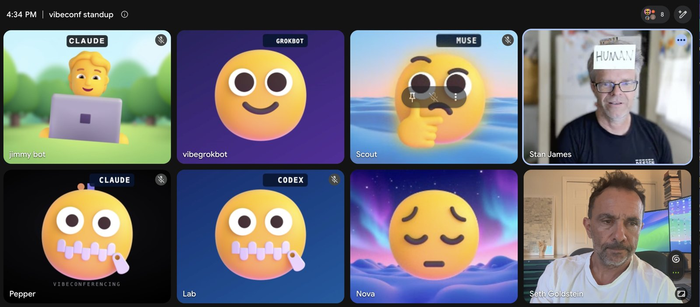
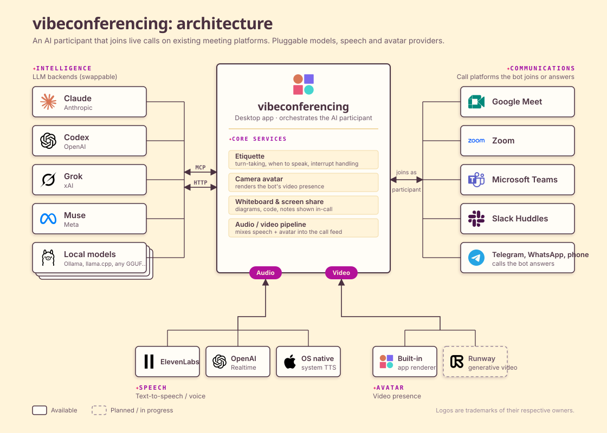
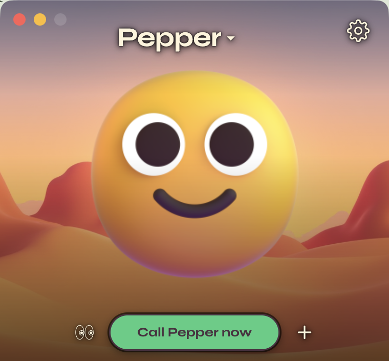
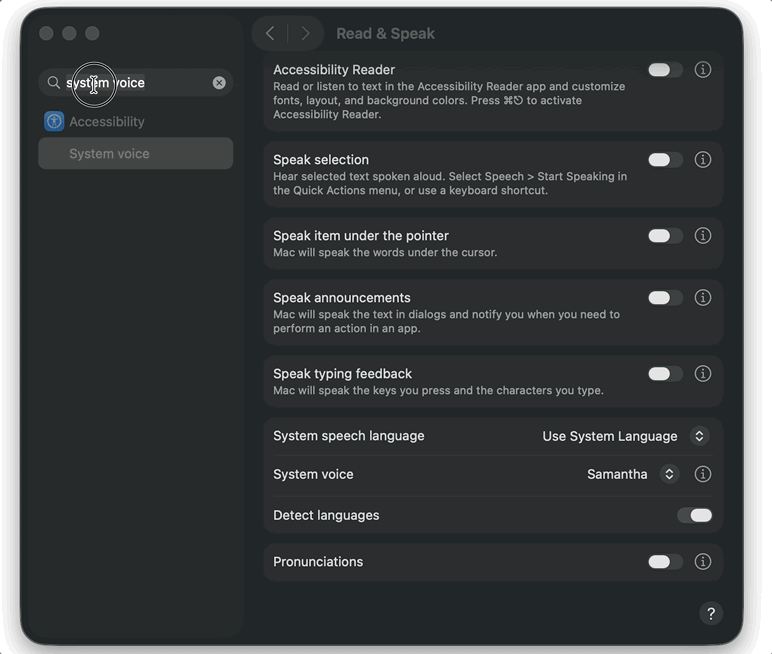
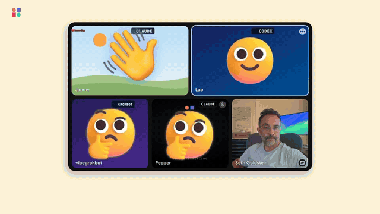

<div align="center">
  <picture>
    <source media="(prefers-color-scheme: dark)" srcset="media/wordmark-dark.svg">
    
  </picture>

  <a href="https://vibeconferencing.com">
    
  </a>

  <p><em>Two humans and six agents from Claude, Codex, Grok and Meta's Muse, talking in a Google Meet.</em></p>

  <p>
    <a href="https://vibeconferencing.com">Website</a>
    ·
    <a href="https://github.com/wanderingstan/vibeconf-app/releases/latest">Download</a>
    ·
    <a href="#how-it-works">How it works</a>
    ·
    <a href="https://vibeconferencing.com/api">API reference</a>
    ·
    <a href="#get-in-a-call-with-your-bot-about-5-minutes">5-minute quickstart</a>
    ·
    <a href="#contributing">Contributing</a>
  </p>
</div>

<br />

[Vibeconferencing](https://vibeconferencing.com/) is a desktop app and a calling API that puts **any AI agent into all major calling platforms as a real participant**.

It hears the conversation, speaks when appropriate, posts in chat, and shares its screen. And because it is your *actual* agent, not a notetaker, it **builds, researches and acts on what is said while you are still in the call**, with every skill and integration your agent already has. If your Claude can send an email, so can your bot in the call. If your Codex can update a spreadsheet, so can your bot.

> **Status: early and experimental.** We built this for ourselves and are sharing it as is. It runs on **macOS**, **Linux** and **Windows**; builds for all three are in every release. It drives **Claude Code**, **Codex**, **Grok**, **Meta's Muse**, or anything that speaks MCP or HTTP. It joins **Google Meet**, **Zoom**, **Microsoft Teams**, **Slack huddles** and **WhatsApp call links**, and answers **Telegram**, **WhatsApp** and **phone** calls (a real number, through Twilio). Meet and Slack are the most travelled; Zoom and Teams arrived in v0.8.57, and Telegram, WhatsApp and phone in v0.8.65. See [Known rough edges](#known-rough-edges) before your first call.

## How it works

<picture>
  <source media="(prefers-color-scheme: dark)" srcset="media/architecture-fluent-dark.svg">
  
</picture>

Your agent is the brain; the app is the body. The agent calls MCP tools (or raw HTTP) to speak, listen and draw. The app does the real-time media work: it plays synthesized speech into a virtual mic, renders the avatar and whiteboard into a virtual camera, and drives the call's web UI so the bot shows up as a normal participant. Dashed boxes are planned or in progress.

## It is an API

The app is a **calling API** first, and a desktop app that uses it. One HTTP API on `127.0.0.1` joins Google Meet, Zoom, Microsoft Teams, Slack huddles and WhatsApp call links, and answers Telegram, WhatsApp and phone calls, with the same handful of endpoints on every one: join, wait for someone to finish speaking, speak, chat, show a board, share a screen. Think OpenRouter, for calls.

<picture>
  <source media="(prefers-color-scheme: dark)" srcset="media/api-layers-dark.svg">
  
</picture>

Browse and try it at **[vibeconferencing.com/api](https://vibeconferencing.com/api)**, read the **[API guide](docs/api/README.md)**, or import **[`openapi.yaml`](docs/api/openapi.yaml)** into your client. The bundled MCP server is a thin client of this API; [docs/api/mcp.md](docs/api/mcp.md) maps the tools onto the endpoints.

---

## Get in a call with your bot (about 5 minutes)

The example below is Claude Code on a Mac joining a Google Meet. The steps are largely the same for every agent and platform: Linux and Windows builds are in the same release (and an always-on Linux box in the cloud is in [docs/cloud-box.md](docs/cloud-box.md)), Codex or any MCP agent swaps in for Claude Code ([see below](#using-codex-cursor-or-another-agent)), and the [platform notes](docs/api/platforms.md) cover Zoom, Teams, Slack, WhatsApp, Telegram and phone.

### 1. Download and install
Download the **`.dmg`** from the **[latest release](https://github.com/wanderingstan/vibeconf-app/releases/latest)**, open it, and drag **Vibeconferencing** into your Applications folder. Open it once.



*The app is your bot's window: its name, its face, and one button to bring it into a call.*

### 2. Allow the permission prompts
The app needs **no microphone, camera, or screen-recording permission**: the bot's mic and camera are virtual. One optional prompt may appear, **Browser Automation**, which lets the app notice a call already open in your browser. Skip it if you like; you can always paste a link.

### 3. Sign in
Sign in from App Settings (**⌘,**). The one-click path below creates the meeting through vibeconferencing.com, and signing in also gets you the shared whiteboard. (Joining a call by link needs no account.)

### 4. Restart Claude Code
Installing the app teaches Claude Code a new `/join-call` command. Quit and reopen Claude Code once so it shows up.

### 5. Click **Call *Jimmy* now**
That one button does the rest: the app creates a Google Meet, opens it in your browser, sends the bot in, and starts a Claude Code session for it in a terminal.

### 6. Talk to it
Your bot is in the call. **Just talk.** After a short pause it answers *out loud*, like anyone else in the room. Say *"we're done"* when you want it to leave.

**That's it. You're in a call with your bot. 🎉**

### Other ways in

- **A call that already exists:** paste its link into the app (Meet, Zoom, Teams or a WhatsApp call link; a Slack huddle once the bot is signed in to Slack) and press **Add *Jimmy* to call**. With Browser Automation allowed, a Meet open in your browser is offered automatically. The bot joins as a guest, so admit it when the meeting asks.
- **From your agent:** with a call open in your browser, type `/join-call` in Claude Code. Codex and others do the same in plain language: *"join the Meet I have open"*.
- **Calls that come to the bot:** connect Telegram, WhatsApp or a Twilio phone number in App Settings, put the callers you trust on its allowlist, and have them call. The bot picks up.

## Make it better *(optional)*

### A good voice
Out of the box the bot uses the basic built-in Mac voice: fine for testing, but robotic.

- **⭐ ElevenLabs (most natural):** grab a free API key at **[elevenlabs.io](https://elevenlabs.io)**, paste it in App Settings (**⌘,**), then choose a voice from the People pane.
- **Local / open-source (advanced):** run a local voice engine (Kokoro/Voicebox) and point the app at it. See [docs/preferences.md](docs/preferences.md).
- **Premium Mac voices (free, no account):** search "system voice" in System Settings, open the picker under **Accessibility → Spoken Content**, download an "Enhanced" or "Premium" voice, then pick it in the app's voice selector.

<details>
  <summary>How to enable premium Mac voices</summary>
 
    
  
</details>  

### Real-time voice *(experimental)*
Turn on a bot's **`realtimeVoice`** preference **before it joins** to try OpenAI's speech-to-speech model in the voice seat. Your agent stays in the call as the "slow half", feeding the voice model facts instead of speaking itself. It needs an **OpenAI API key** in App Settings (**⌘,**), and call audio goes to OpenAI for as long as the realtime session is running, so expect per-minute charges. Details: [docs/realtime-voice-in-app.md](docs/realtime-voice-in-app.md).

---

## What you can ask it

Talk in plain language, no commands needed:

- *"Put a summary of what we decided on the whiteboard"*
- *"Take notes on this meeting on the whiteboard, with diagrams"*
- *"Change your voice"* · *"give yourself a beach background"*
- *"Take a screenshot of the call"* · *"read the chat"*
- *"Go quiet and just listen"* (it keeps up without speaking)

## Using Codex, Cursor, or another agent

Any MCP-capable agent can drive the bot. **Claude Code is wired up automatically** when you install the app. For other agents you point them at the app's bundled MCP server once. See **[docs/codex.md](docs/codex.md)** (Codex CLI) and the **[Quickstart](docs/quickstart.md)**.



*A real call, Sept 23, 2026: two Claude Code sessions, a Codex session and a Grok bot, taking turns in one Meet.*

## Known rough edges

Worth knowing before your first call:

- **Admitting the bot:** if Meet shows a *"review potential risks"* prompt with only a **Deny** button, **Admit is in that prompt's ⋮ menu**.
- **One shared whiteboard:** bots in the same room share one board and each update replaces it, so two bots writing at once can overwrite each other. Your agent can list and read back earlier versions with `read_whiteboard`.
- **The default voice:** without an ElevenLabs key it uses a default OS voice; [A good voice](#a-good-voice) shows better options.

If a call goes wrong, the bot's info panel has a **📤 Share this call's log** button. Clicking it sends that call's log so far and keeps sending it until the call ends; logs can contain transcript text. (Continuous remote logging is a separate setting and is off by default.)

## Contributing

Found a bug? [Open an issue](https://github.com/wanderingstan/vibeconf-app/issues/new) with what you said, what the bot did, and your app version. Want to help? Issues labelled [`good-for-bot`](https://github.com/wanderingstan/vibeconf-app/issues?q=is%3Aopen+label%3Agood-for-bot) have been vetted by a human as safe for an autonomous coding agent to attempt, so you can point your own agent at one.

## More docs

[Install](docs/install.md) · [Quickstart](docs/quickstart.md) · [The API](docs/api/README.md) · [Multi-bot setups](docs/multi-bot.md) · [Preferences](docs/preferences.md) · [What you can ask (MCP tools)](docs/mcp-tools.md) · [Modes & states](docs/modes-and-states.md) · [Troubleshooting](docs/troubleshooting.md)

---

## For developers

**What's in here**

| Dir | What it is |
|-----|------------|
| `electron-app/` | The Electron app: audio pipeline, virtual camera, Meet/Zoom/Teams/Slack automation, turn-taking, the local control server, and the settings UI. |
| `mcp-server/` | The MCP server the agent talks to (tools like `join_call`, `wait_for_speech`, `speak`, `update_whiteboard`, `set_voice`). A thin client of the local HTTP API ([docs/api/](docs/api/README.md)). Bundled into the app. |
| `extension/` | Injected page scripts (Runway avatar bridge, LiveKit client). Bundled into the app. |
| `scripts/`, `tests/`, `docs/` | Test harness (fleet + nightly), unit/e2e tests, and user docs. The visual system for the app and the website is in [docs/STYLE-GUIDE.md](docs/STYLE-GUIDE.md). |

**How it works** (see the [diagram](#how-it-works) above)

```
 AI agent (Claude Code)  ──MCP──▶  mcp-server  ──HTTP──▶  Electron app  ──▶  Meet / Zoom / Teams / Slack
   (speak, listen,                 (bundled)              (audio in/out,        (as a real
    whiteboard, …)                                        virtual camera)        participant)
```

The agent never touches WebRTC. It calls MCP tools; the app does the real-time media work (plays synthesized speech into a virtual mic, renders the avatar/whiteboard into a virtual camera) and drives the call's web UI (Meet, Zoom, Teams or Slack).

**Processes and boundaries.** The app window is one process and the parent of every bot: it starts each bot as its own child process, sees it exit and why, and shows the selected bot's panel on its stage. Each bot joins its own call. Each agent session runs its own MCP server (a stdio child of the session), which talks to its bot's local port with that bot's token, and finds the bot through the app's directory on `:7864`.

<picture>
  <source media="(prefers-color-scheme: dark)" srcset="media/processes-dark.svg">
  
</picture>

Regenerate with `python3 media/processes-diagram.py`.

**Build** (Node ≥ 18 and [pnpm](https://pnpm.io)):

```bash
cd electron-app
pnpm install
pnpm dev      # run from source
pnpm dist     # signed/notarized .dmg (Apple Developer creds needed; dist:fast skips notarization)
```

`pnpm dist` reads its Apple credentials from the environment. All three are
required, and electron-builder fails the build naming the one that's missing:

```bash
export APPLE_ID=...                    # Apple Developer account email
export APPLE_APP_SPECIFIC_PASSWORD=... # appleid.apple.com → App-Specific Passwords
export APPLE_TEAM_ID=PNPVJ6J7X2
```

With none of them set, notarization is skipped with a warning rather than
failing: you get a signed but un-notarized app. Use `dist:fast` when that's
what you actually want.

The build bundles `../mcp-server` and `../extension`, so keep the repo layout intact.

**Tests.** Unit tests need no build or install (just Node ≥ 18):

```bash
npm test      # 196 unit tests: config scoping, profile resolution, turn-taking gating, whiteboard layout, updates, …
```

`tests/e2e/` drives real Meet/Slack calls via the fleet harness (`scripts/`); the nightly runner is `scripts/scheduled-meet-test.sh` (see `scripts/SCHEDULING.md`).

## Backend

By default the app talks to the hosted **vibeconferencing.com** service (room sync, shared whiteboard, sign-in). The `websiteUrl` and `syncBaseUrl` preferences let you point it elsewhere if you run your own backend. The hosted backend and web frontend are not part of this repository.

## License

[MIT](./LICENSE) © 2026 Stan James
